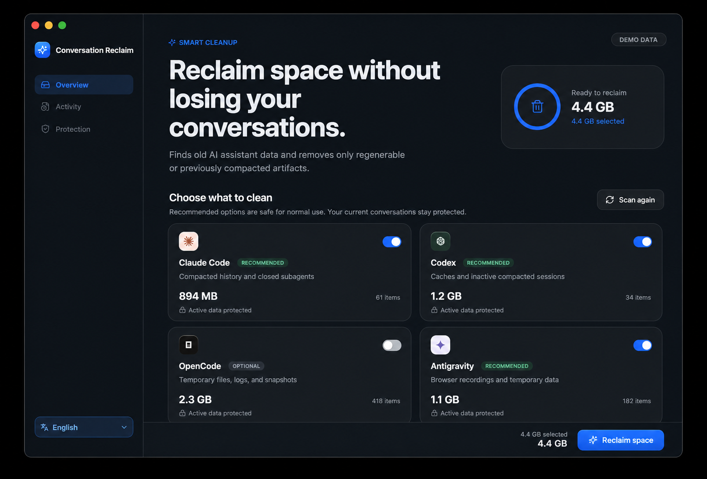
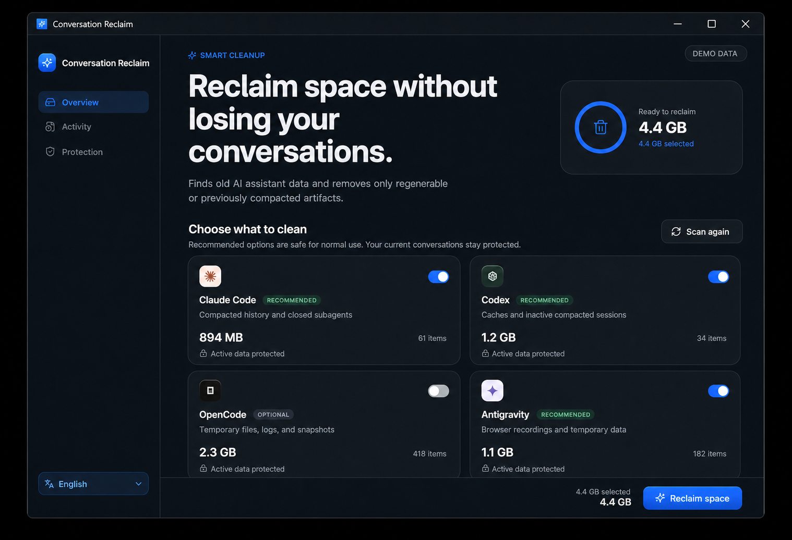

# conversation-reclaim

*[Versión en español](LEEME.md)*

> **Tested on macOS.** Linux should work. **Windows: NOT tested yet** — the
> tool is multi-platform by design and includes path detection for Windows,
> but if you run it there you are the pioneer. See
> [Windows notes](#windows-notes-how-to-find-what-to-clean).

Reclaim the disk space your AI conversations silently eat — **without breaking
them**.

Every AI coding agent keeps a full copy of every conversation on disk. When a
conversation hits the context limit it gets **compacted**: the model summarizes
everything so far into a few paragraphs and keeps going. But the original
content is **never deleted** — it stays on disk, useless, waiting for a resume
that will only load the summary and the latest messages.

```
1 → 100 (full conversation)          compacted → summary A
1 → 100 (full conversation)          compacted → summary B (includes A)
1 → 100 (full conversation)          compacted → summary C (includes B)
```

That was a 776 MB conversation we found — of which **774 MB was pre-compaction
garbage**. And it's not only compactions: OpenCode keeps an event log where
every streaming update stores a full copy of the message (one session reached
**4.7 GB** of redundant events), Antigravity leaves gigabytes of browser-mode
screenshots, and agents copy the same skills into four different folders.

This tool detects the **last compaction marker** of every conversation and
trims everything before it — keeping the summary and the recent messages
intact. Then it cleans the other disposable data: snapshots, tool-outputs,
logs, caches, browser recordings and closed subagent transcripts. It previews
these destructive categories first; a full external backup is optional.

## Native desktop preview

| macOS | Windows 10/11 |
|---|---|
|  |  |

The values shown are clearly labeled demonstration data; the installed app
calculates the real reclaimable space locally. The macOS image is based on the
native app, while the Windows image is a platform-frame preview pending a real
Windows capture from the published build.

## Designed for AI agents — and for humans

Three ways to use it:

1. **By an AI agent (recommended)** — the repo ships an agent skill
   (`skills/conversation-reclaim/SKILL.md`). Install it and just tell your
   agent *"libera espacio de mis conversaciones"* (or *"free up space from my
   conversations"* — the tool speaks your language). The skill knows the
   markers, the safety rules and the preview-first workflow. This is how the
   author uses it.
2. **Visual interface** — a native Tauri 2 application with a React interface
   and Rust cleanup engine. It follows the system light/dark appearance, adapts
   to small windows, remembers Español/English, preselects recommended cleanup,
   and asks for confirmation before writing. The portable app is independent
   from the Python CLI: end users do not install Python, Node, or Rust.
3. **Manually from a terminal** — a plain Python CLI (stdlib
   only), no dependencies, no install. Run `scan` first, review the numbers,
   then `apply` with a backup destination:

### Download choices

The [GitHub Releases](https://github.com/ANGELBERRIOS23/conversation-reclaim/releases)
provide native downloads generated by GitHub Actions:

- **Windows x64 Setup (recommended):** installs the app and enables signed
  automatic updates.
- **Windows x64 portable:** unzip and run it without installing. Use Setup if
  you want seamless updates.
- **macOS Apple Silicon:** unzip the `macOS-arm64` package and open the app.
- **macOS Intel:** unzip the `macOS-x64` package and open the app.

Those packages contain the compiled React/Rust application; end users install
nothing and do not need Python. Unsigned
development builds may require **right-click → Open** on macOS or confirmation
through Windows SmartScreen. The app checks the latest GitHub Release at launch;
an available update is shown under Protection and is installed only after the
user chooses **Install and restart**. Every update is cryptographically signed
and verified before installation. A tagged version (`v*`) builds the native
packages, updater metadata and signatures, then attaches them to its release.

```bash
python3 reclaim.py scan                    # read-only estimate
python3 reclaim.py apply                   # apply; writes a change manifest to ~/.conversation-reclaim/
python3 reclaim.py apply --backup-dir /Volumes/DISCO/respaldos-ia   # optional full backup first
python3 reclaim.py apply --only antigravity   # one tool only
python3 reclaim.py apply --only media         # only old temporary image attachments (optional)
python3 reclaim.py apply --include-media      # include old temporary attachments in a full cleanup
python3 reclaim.py scan --extras             # also measure the optional extras below
python3 reclaim.py apply --only images --trash        # images inside old Claude Code / Codex chats
python3 reclaim.py apply --only codex-work --trash    # screenshots and drafts in Codex work/ folders
python3 reclaim.py apply --only old-versions --trash  # old Claude Code / Codex versions and leftovers
python3 reclaim.py apply --extras --older-than 30     # all extras, only what hasn't changed in 30 days
python3 reclaim.py outputs                    # Codex outputs biggest first; flags copies and v1/v2 versions
python3 reclaim.py outputs --to-trash 3 7 12  # move only the numbers you choose to the Trash
python3 reclaim.py outputs --external /Volumes/DISK  # also look for copies on an external disk
python3 reclaim.py generated                  # Codex generated images; recommended ones (already copied) first
python3 reclaim.py generated --to-trash 1 2   # move only the images you choose to the Trash
python3 reclaim.py apply-db --backup-dir /Volumes/DISCO   # prune opencode.db (opencode closed, backup required or --no-backup)
python3 reclaim.py apply-db --no-backup --close-opencode  # warn, quit OpenCode normally, then prune
python3 reclaim.py apply-db --backup-dir /Volumes/DISCO --drop-v1-copy  # OpenCode 2: also drop the leftover OpenCode 1 copy
python3 reclaim.py skills                  # list skills + find duplicates
python3 reclaim.py restore --backup-dir /ruta
```

**Backups are optional, not the default.** `apply` does not copy anything to
an external disk unless you pass `--backup-dir`. Without it, every change is
still recorded in a manifest at `~/.conversation-reclaim/manifest-<date>.jsonl`
(file, bytes cut, marker offset, timestamp), and the JSONL trims are atomic
(temp file + rename), so an interrupted run leaves the original intact.
`apply-db` is the only irreversible operation: it **requires** an explicit
`--backup-dir` (or `--no-backup` to accept the risk).

Language: the output follows `$RECLAIM_LANG`, then `$LANG`, or use
`--lang es|en`. Ask the tool in Spanish and it answers in Spanish; ask in
English and it answers in English.

## What it cleans, per tool

| Tool | Storage | Compaction marker | What `apply` does |
|---|---|---|---|
| **Claude Code** | `~/.claude/projects/**/*.jsonl` | structured summary/compaction event | trims before the last marker + removes closed sidechains |
| **Codex** | `~/.codex/cache/` | — | removes regenerable cache files; all session and archived rollouts remain intact |
| **OpenCode** | `~/.local/share/opencode/opencode.db` | part `type=compaction` with `tail_start_id` | `apply-db`: redundant streaming events + pre-compaction messages + VACUUM. OpenCode 2: `--drop-v1-copy` removes the OpenCode 1 copy left after upgrading |
| **OpenCode (files)** | `snapshot/`, `tool-output/`, `log/` | — | all local snapshots, tool outputs, logs |
| **Antigravity / Gemini** | `~/.gemini/antigravity{,,-cli,-ide}/conversations/*.db` | steps `step_type 98` (CONVERSATION_HISTORY) | prunes pre-compaction steps + transcripts, scratch, logs, caches, `browser_recordings` |
| **Temporary media (optional)** | OS temp `codex-clipboard-*` and Antigravity `tempmediaStorage` | older than 7 days, regular file, not open | deletes only structurally identified temporary images; old chat previews may disappear |
| **Command Code** | `~/.commandcode/projects/` | none detected | scan/backup only |
| **Conversation images (extra)** | Claude Code `~/.claude/projects` and Codex `~/.codex/sessions` (`.jsonl` and `.jsonl.zst`) | unchanged for N days (default 14) | rewrites the chat without its base64 images: images the model saw become a short text, UI copies become a 1×1 PNG; every other line stays byte-for-byte identical and the chat can still be resumed |
| **Codex work files (extra)** | `~/Documents/Codex/<date>/<task>/work/` and `~/.codex/generated_images` | unchanged for N days | removes images and videos in `work/` only when the task has files in `outputs/`; never `outputs/`, never inside a git repo; generated images go only if an identical copy exists outside `work/` |
| **Old versions and leftovers (extra)** | `~/.local/share/claude/versions`, Claude desktop `claude-code/`, `~/.codex/packages/standalone/releases`, `~/.claude/file-history`, Codex `*.bak-*` | version in use and newest always kept; restore points and backups unchanged for N days | removes old program versions, old restore points, and repair backups |

## The OpenCode database problem (opencode-db-prune, integrated)

OpenCode's `opencode.db` event-sources every message: each streaming update
writes a full snapshot of the part. A long session generates hundreds of
thousands of rows of pure duplication — in our case 147k rows / **4.4 GB** of a
4.9 GB database, 90%+ redundancy. `apply-db` removes those redundant events,
then prunes pre-compaction messages, then `VACUUM`s. This is a merge of the
dedicated [opencode-db-prune](https://github.com/ANGELBERRIOS23/opencode-db-prune)
project (use it directly if you only care about the DB).

### OpenCode 2

OpenCode 2 empties that event log itself, but on its first start it copies
every conversation into new tables (`session_v2` / `session_message`) and
leaves the OpenCode 1 copy (`message` / `part`) behind. It records the import in
`kv` as `migration.v1-v2 = completed` and never reads the old copy again, so
after upgrading the database holds every conversation twice.

`scan` shows that copy next to OpenCode as *OpenCode 1 copy*. `apply-db
--drop-v1-copy` removes it session by session, and only when every text,
reasoning block and tool output of the old copy is also in the new tables;
any session that fails the check keeps its old copy. On a real upgrade (120
sessions) it dropped 114, kept 6 and took the database from 269 MB to 143 MB,
and OpenCode 2 exported a 261-message session identically before and after.

Two more differences with OpenCode 2:

- With OpenCode 2 already imported, `apply-db` no longer prunes pre-compaction
  messages from the old copy: in the sessions that fail the check, those may be
  the only place where some pieces still exist.
- The database is held open by OpenCode 2's background service, not by a
  window. `--close-opencode` stops it with `opencode service stop`; it never
  kills the process.

## Safety

- **Backup optional but recommended.** `apply` without `--backup-dir` never
  copies data anywhere; instead it writes a change manifest to
  `~/.conversation-reclaim/` and uses atomic file replacements (an interrupted
  run leaves originals intact — see the skill for manual fallback recipes).
- `apply-db` requires an explicit backup (`--backup-dir`) or `--no-backup`.
- Refuses to touch `opencode.db` while opencode is running. With OpenCode 2
  that includes its background service (`opencode service stop`).
- `--drop-v1-copy` only acts after OpenCode 2 marked its import as completed,
  and only on sessions whose old copy is fully present in the new tables.
- `--close-opencode` warns and requests a normal app quit before pruning on
  macOS and Windows. Windows uses Restart Manager to identify the exact holders
  and sends `WM_CLOSE`; it never uses forced `taskkill`.
  It refuses when OpenCode is an ancestor/host of the running command, so it
  never terminates the agent executing the cleanup. Run that command from
  Terminal, Codex or another external harness.
- Pre-flight check: won't delete events if the content only lives in the event
  table.
- Integrity checks (`PRAGMA integrity_check`) after DB operations.
- Antigravity conversation DBs are skipped if the app has them open.
- Codex session, archived, and subagent rollouts are never shortened or deleted.
- Claude sidechains, including `agent-acompact-*`, are validated from their
  JSON metadata and deleted only when they are not open.
- Before deleting Claude sidechains or Antigravity `browser_recordings`,
  the CLI prints their count and size. Browser recordings are already-consumed
  screenshots and Antigravity does not reuse them.
- Temporary media is separate and **off by default**. `--only media` or
  `--include-media` removes only old `codex-clipboard-*` files and images in
  Antigravity's explicit temporary-media folders. Files newer than seven days,
  files in use, symlinks, and images in normal brain/project folders are kept.
  An old conversation may lose its local image preview after this cleanup.
- Cleanup may run from inside Codex: Codex rollouts are preserved by every
  default category; regenerable cache files remain eligible. Only the
  optional **conversation images** extra rewrites a rollout, and it keeps
  `session_meta`, line order, and every line without images untouched.
- `outputs` never deletes anything by itself: it lists what Codex delivered
  (`~/Documents/Codex/*/*/outputs`) from biggest to smallest, marks files that
  already have an identical copy outside `~/Documents/Codex` and older `v1`/`v2`
  versions, and moves to the Trash only what you pick. The app has the same
  list in its **Large files** page.
- `generated` does the same for `~/.codex/generated_images`: images that
  already have an identical copy outside Codex `work/` folders are marked as
  recommended and listed first, with the chat title. In the app, the **Large
  files** page has a **Generated images** tab with thumbnails (the app may
  only read that folder to show them).
- Extras are **off by default** and only touch what hasn't changed in N
  days (`--older-than`, default 14; the app has the same setting). With
  `--trash` everything goes to the Trash, including the original of every
  rewritten chat, so nothing is lost until you empty it. Cowork sessions are
  never rewritten: each line carries a signature (`_audit_hmac`) that would
  stop matching.

### Repair rollouts damaged by earlier versions

Earlier versions trimmed Codex files from a `compacted` event, removing the
required leading `session_meta` record. First run a dry run:

```bash
python3 scripts/repair_codex_sessions.py
```

If you have a complete earlier Conversation Reclaim backup, pass its root with
`--originals-root /path/to/conversation-reclaim-backup`. The repair tool uses a
full original only when it ends with the current rollout. Otherwise it rebuilds
the missing metadata from `~/.codex/state_5.sqlite`. To apply the plan, pass
`--apply --backup-dir /path/to/new/empty/backup-directory`. A byte-for-byte
copy of each current file is verified before replacement. A reconstructed
header makes the retained transcript readable; it cannot restore history
already removed by the earlier trim.
- Skills are **only listed**, never deleted (duplicates can be deduplicated
  with symlinks).
- Caches (tool-output, logs, snapshots, scratch) are safe to delete — prompt
  caching lives on the server, it does not cost tokens.

### Local usage reports and billing

Cleanup never changes provider billing, API charges, subscription usage,
invoices, or server-side account records. However, tools such as
[ccusage](https://github.com/ccusage/ccusage) build their historical reports
from local agent logs. Trimming a transcript or deleting an old session can
therefore make older local totals and session breakdowns lower or incomplete.
Export the ccusage report to JSON before cleanup if that local history matters
to you.

## Windows notes: how to find what to clean

The desktop app targets **64-bit Windows 10 version 1803 or later** and Windows
11. Tauri uses the system Microsoft Edge WebView2 runtime, which is distributed
with those Windows versions. The cleanup paths still need broader real-world
testing, so feedback from Windows users is welcome:

| What | Windows path |
|---|---|
| Claude Code conversations | `%USERPROFILE%\.claude\projects\<proyecto>\<uuid>.jsonl` |
| Codex sessions | `%USERPROFILE%\.codex\sessions\<año>\<mes>\<día>\rollout-*.jsonl` |
| OpenCode database | `%USERPROFILE%\.local\share\opencode\opencode.db` (also `%LOCALAPPDATA%\opencode\data` or `%APPDATA%\opencode`) |
| OpenCode snapshots / tool-output / logs | same directory as the DB |
| Antigravity / Gemini | `%USERPROFILE%\.gemini\antigravity{,,-cli,-ide}\...` |
| Antigravity desktop logs | `%APPDATA%\Antigravity\logs` and `%APPDATA%\Antigravity IDE\logs` |
| Command Code | `%USERPROFILE%\.commandcode\projects` |
| Skills | `%USERPROFILE%\.claude\skills`, `%USERPROFILE%\.config\opencode\skills`, `%USERPROFILE%\.agents\skills` |

Notes for Windows users:

- Open-file detection uses the native Windows file-sharing API, so active
  histories are skipped even without `lsof`. Restart Manager reports the exact
  processes holding `opencode.db`; `--close-opencode` can request a normal
  OpenCode window close but refuses unknown holders and never force-kills.
- The JSONL truncation works exactly the same: the file is rewritten from the
  last compaction marker onward.
- Antigravity paths under `%USERPROFILE%\.gemini` are the same on Windows.
- If you find a path that differs, open an issue or a PR — the project wants
  to be truly cross-platform.

## Verified results (macOS, author's machine)

- Claude Code: 1.8 GB → 355 MB (one conversation was 776 MB, 774 MB of it
  pre-compaction garbage).
- OpenCode DB: 4.9 GB with 4.7 GB of redundant events (147k rows).
- Antigravity/Gemini: 19 GB → 4.6 GB (conversation pruning + browser
  recordings + backups the user no longer needed).
- Skills: 12 duplicates found across 5 skill roots (~17 MB, dedup via symlinks).

## Disclaimer

**No warranty, use at your own risk.** This tool deletes data (pre-compaction
conversation content, caches, subagent transcripts, redundant events). It is
designed to keep your conversations working — the summary and recent messages
are preserved — but you are **fully responsible for what you ask your AI agent
to delete**. If you remove an important conversation, that is the caller's
decision, not this project's. Always review `scan` output before `apply`, and
use `--backup-dir` when in doubt.

## Contributing — new harnesses welcome

This project wants to cover **every AI coding harness**, not just the current
ones. Contributions for **Cursor, Kiro, Ghost, Trae, the DeepSeek harnesses,
or anything else** are welcome — including a harness you are building yourself.

The native app uses a discoverable `Harness` registry: each integration owns
its metadata, permitted roots, scan rules, and cleanup plan in one module.
The dashboard and executor discover registered integrations automatically and
show a neutral fallback logo when no brand asset exists. See the concise
[adding a harness guide](docs/ADDING_A_HARNESS.md).

PR checklist (so the maintainers can trust and verify it):

1. **State the OS you tested on** (e.g. "tested on Windows 11 Pro 24H2",
   "tested on macOS 15, Linux not tested").
2. **State the tool name and a URL** — the CLI/app repository, marketplace
   page or docs link — so the maintainers can verify the tool actually exists
   and how it stores data before reviewing.
3. Explain **where the data lives** and **what the compaction marker is**
   (a JSONL field, a SQLite table/column, an event type...). Reuse the same
   patterns: `scan_<tool>()` + `apply_<tool>()` + an entry in `PATHS`.
4. Show the `scan` output for your tool before/after, and confirm resume works
   after trimming.
5. **Every PR gets a human review** before anything is merged. No automation
   merges external code. Keep changes in one file (`reclaim.py`) plus docs.

Even if you don't write code: open an **issue** with the tool name, where its
conversations live, and a sample of the storage format — that is already a
great contribution.

## Development checks

The Python CLI remains stdlib-only. Run both regression suites with:

```bash
python3 -m unittest discover -v
npm ci
npm run build
cargo test --manifest-path src-tauri/Cargo.toml
```

To build the native package for the current operating system (contributors
need Node.js, Rust, and the Tauri system prerequisites):

```bash
npm ci
npm run tauri build -- --bundles app       # macOS .app
# Windows: npm run tauri build -- --no-bundle
```

It covers structured markers, atomic permission-preserving rewrites, subagent
detection, manifests, totals, OpenCode transactions and CLI exit codes.

## License

MIT — see [LICENSE](LICENSE).
